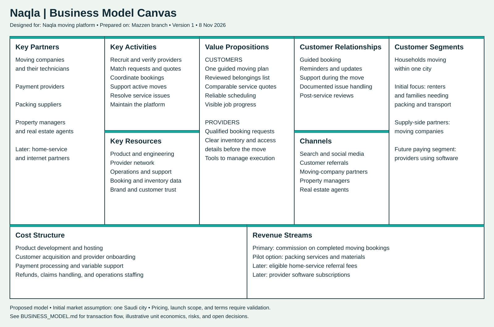

# نقلة | Naqla

Naqla is a proposed moving-service app that helps customers plan a move, organize their belongings, book services, and follow progress. A separate technician experience supports assigned jobs, transport, and delivery.

## What I’m currently working on

I’m developing the product concept and documenting the visual identity and app workflows on the **`Mazzen` branch**.

My current focus is:

- **Brand identity:** Arabic and English logo direction, logo variants, app icon, and color palette.
- **Customer experience:** Moving plans, room inventory, service booking, scheduling, live tracking, and ratings.
- **Technician experience:** Assigned tasks, job details, task acceptance, collection and delivery, progress updates, and completion reports.
- **Documentation:** Recording the design references, prompts provided, and proposed behavior before implementation.
- **Business planning:** Defining the marketplace model, revenue streams, operating costs, and a focused launch pilot.

## Current progress

| Area | Status |
| --- | --- |
| Branding reference | Documented from the supplied concept image |
| Customer workflow | Documented |
| Technician workflow | Documented |
| Business model | Drafted; pricing and market assumptions need validation |
| Reference images | Supplied in chat; files are not yet stored in this repository |
| App implementation | Not started in this repository |

## Planned app journeys

**Customer:** Register → Create a moving plan → Inventory belongings → Choose services → Schedule and pay → Track the request → Confirm completion and rate.

**Technician:** Receive assigned tasks → Review job details → Accept a task → Collect and transport belongings → Update progress → Deliver and complete the job.

These journeys describe the proposed design. The repository does not yet contain a runnable app or automated tests.

## Work log and design details

### Business model canvas

[Open the full-size canvas](docs/business-model-canvas.svg). This proposed model follows the nine-section layout in the supplied reference; market and pricing assumptions still need validation.

See [BUSINESS_MODEL.md](BUSINESS_MODEL.md) for the business model canvas, revenue strategy, illustrative unit economics, launch plan, risks, and open decisions.

See [UPDATES.md](UPDATES.md) for the detailed workflows, brand palette, reference descriptions, and the prompt used to request the documentation.

## Branch workflow

Keep this work on **`Mazzen`**. Do not commit or push to `main` without first contacting Meshal (مشعل). Team members should work on their own branches.
